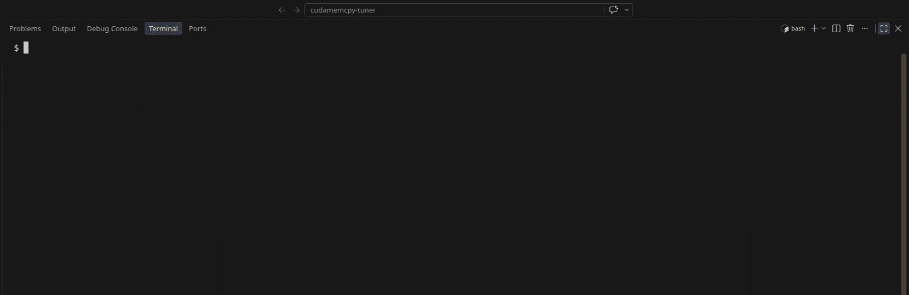
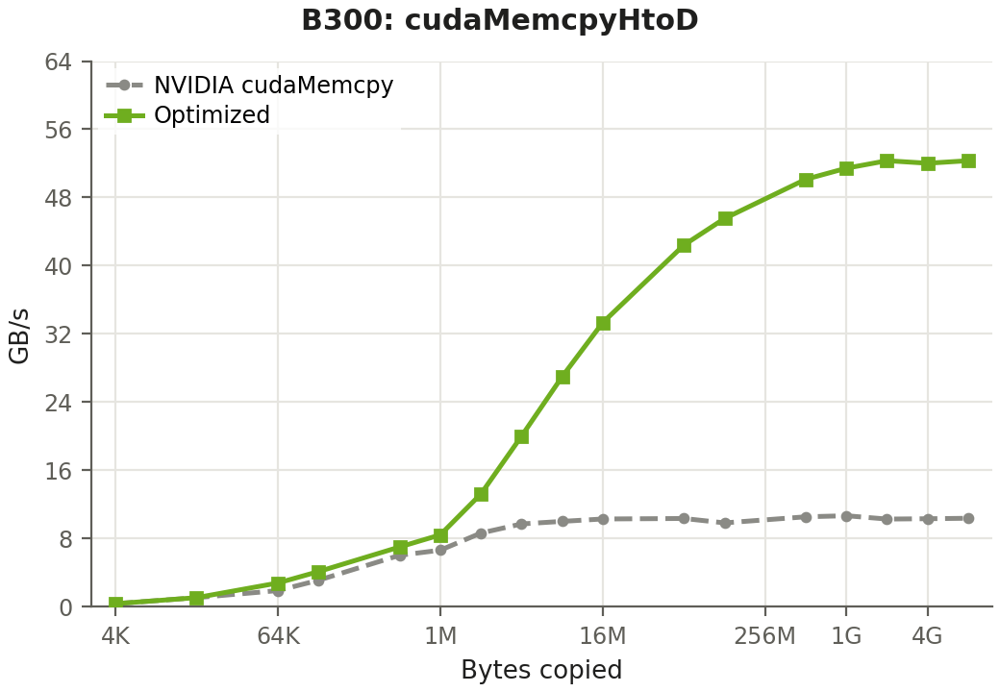
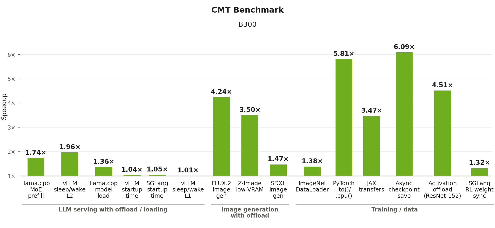

# cudamemcpy-tuner

Faster CPU <-> GPU copies for CUDA applications.

Just add `cmt tune --` to your command:

```sh
cmt tune -- llama-bench -m Qwen3.6-35B-A3B-Q8_0.gguf -ngl 99 -fa 1 -ot exps=CPU -p 2048 -n 0 -r 3
```



## Performance





## Build

```sh
cmake -S . -B build -DCMAKE_BUILD_TYPE=Release
cmake --build build --parallel
```

[Blog](https://maknee.github.io/blog/2026/CudaMemcpy/) · [Shared tunes](tunes/) · [Evaluation](evaluation/) · [Website](site/)

Apache-2.0 ([LICENSE](LICENSE)); NVIDIA kernel patches are
[GPL-2.0-only](kernel_patches/nvidia-open/COPYING).
